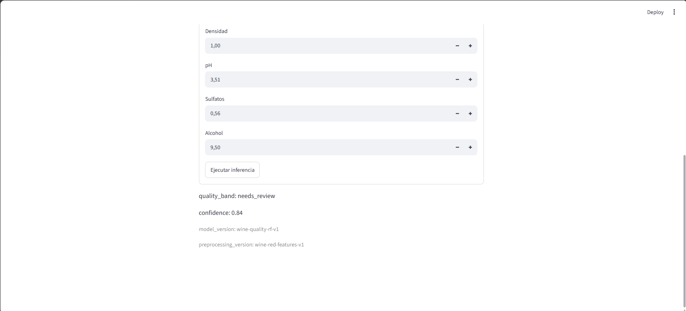
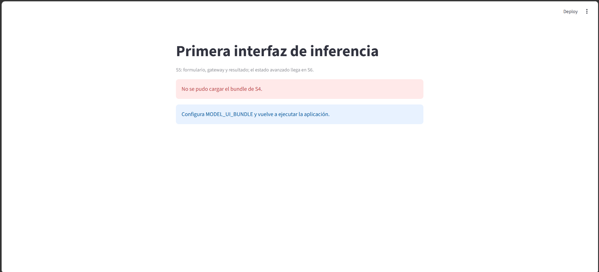

# Práctica 5.2 — Streamlit Wine Quality

## Descripción

Interfaz desarrollada con Streamlit para predecir la calidad del vino utilizando el bundle real de la semana 4.

La aplicación permite introducir las 11 características definidas en `FIELD_SPECS` y ejecutar la inferencia mediante `gateway.predict(values)` al enviar el formulario. El resultado muestra `quality_band`, `confidence`, `model_version` y `preprocessing_version`.

## Configuración y ejecución

Desde el directorio `starter` de la semana 5, instalar las dependencias:

```powershell
uv sync
```

Configurar la variable de entorno `MODEL_UI_BUNDLE` con la **ruta absoluta a la carpeta** del bundle de S4. La carpeta debe contener `manifest.json` y `model.joblib`:

```powershell
$env:MODEL_UI_BUNDLE = (Resolve-Path "..\..\..\..\..\..\..\semana4\modules\04-model-packaging\exercises\01-model-packaging\01.02-serializable-inference-module\problem\starter\models\wine_quality_bundle").Path
```

Ejecutar la aplicación en la misma terminal:

```powershell
uv run --with 'streamlit>=1.40,<2.0' streamlit run app.py
```

## Pruebas

Ejecutar las pruebas automatizadas:

```powershell
uv run python -m pytest -q
```

**Resultado: 27 tests superados.**

Comprobar la calidad y el formato del código:

```powershell
uv run ruff check app.py src tests
uv run ruff format --check app.py src tests
```

## Matriz de QA

| Caso | Comprobación | Resultado |
|---|---|---|
| Bundle real | Se muestran los 11 campos y se obtiene una predicción con el bundle de S4. | OK |
| Edición | Modificar los valores del formulario no ejecuta ninguna inferencia. | OK |
| Submit | Enviar el formulario ejecuta una única llamada a `gateway.predict(values)`. | OK |
| Bundle ausente | Se muestra un mensaje de error seguro, sin traceback ni rutas internas. | OK |

## Evidencias

- Captura de la aplicación funcionando con el bundle real de S4.

- Captura del mensaje de error al ejecutar sin bundle.
