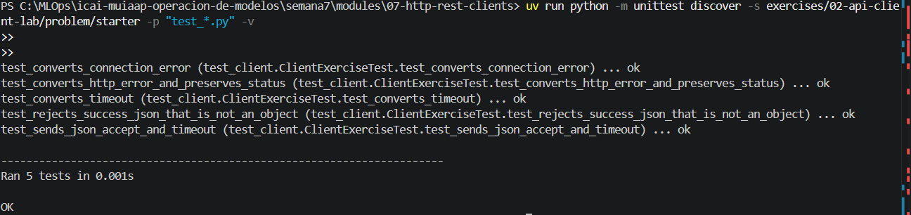
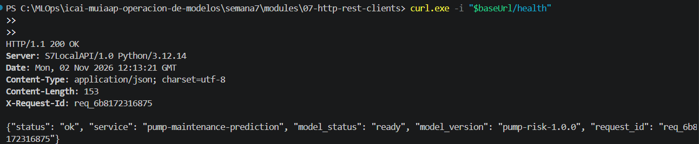
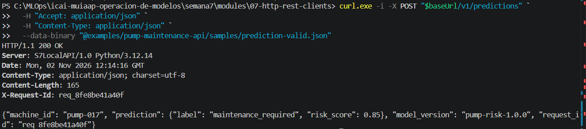
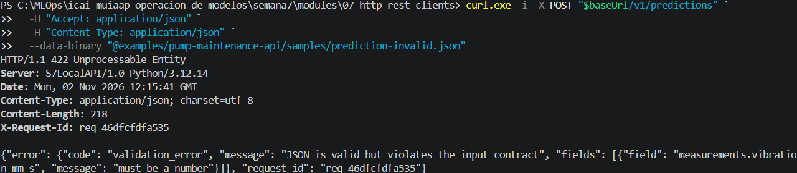

# Ampliación posterior a la clase 1 — consumir una API de predicción

Este laboratorio es una **ampliación posterior a la clase 1** o assignment;
**no es la clase 2**. La clase 2 continúa el proyecto Wine Quality en
[`03-wine-http-gateway`](../../03-wine-http-gateway/README.md).

## Objetivo

Consumir una API local ya preparada con curl y Python. Postman queda como
ampliación opcional. No abras ni modifiques el servidor: el trabajo está en el
lado cliente.

## 0. Arranque y salud

Desde la raíz del módulo:

```text
uv run python examples/pump-maintenance-api/server.py
```

En otra terminal ejecuta el `GET /health` de la [guía curl](../../../examples/curl/README.md).

**Comprobación:** obtienes `200`, `status: ok`, `model_status: ready` y un
`request_id`.

## 1. Observar el contrato con curl

Ejecuta el POST válido y el inválido ya preparados.

**TODO 1:** registra método, path, `Content-Type`, status, `request_id` y el
campo rechazado. Explica por qué el segundo caso es `422`, no `400`.


**POST valido:**

path: http://127.0.0.1:8000/v1/predictions

Content-Type: application/json

status: OK

request_id: req_dd7b00307a0d

{"machine_id": "pump-017", "prediction": {"label": "maintenance_required", "risk_score": 0.85}, "model_version": "pump-risk-1.0.0", "request_id": "req_dd7b00307a0d"}

**POST inválido:**

path: http://127.0.0.1:8000/v1/predictions

Content-Type: application/json

status: 422 Unprocessable Entity

request_id: req_2f11a36fdde2

El campo rechazado es vibration_mm_s

El error es 422 porque la petición es correcta y la sintaxis del JSON es válida pero los datos no cumplen las reglas de validación

{"error": {"code": "validation_error", "message": "JSON is valid but violates the input contract", "fields": [{"field": "measurements.vibration_mm_s", "message": "must be a number"}]}, "request_id": "req_2f11a36fdde2"}

**Comprobación:** no confundas `maintenance_required` con un error HTTP; el
primer status sigue siendo `200`.

## 2. Ampliación opcional con Postman

Completa el [ejercicio Postman](../../../examples/postman/README.md). La
colección sirve para comprobar el resultado, pero reconstruye al menos una
petición manualmente.

**TODO 2 opcional:** prepara una tabla de evidencia con salud, éxito y
validación.

## 3. Completar el cliente Python

Trabaja en `starter/client.py` y ejecuta:

```text
uv run python -m unittest discover -s exercises/02-api-client-lab/problem/starter -p "test_*.py" -v
```

Los cinco tests empiezan en rojo por el `NotImplementedError` intencional.

**TODO 3 — petición:** usa `session.post()` con:

- URL terminada en `/v1/predictions`;
- `json=payload`, no `data=str(payload)`;
- `headers={"Accept": "application/json"}`;
- `timeout=timeout`.

Esto es necesario para serializar correctamente el cuerpo, expresar el formato
esperado y limitar la espera. Comprueba que pasa el test de argumentos.

**TODO 4 — status:** llama a `response.raise_for_status()`. Convierte
`requests.HTTPError` en `PredictionClientError` conservando el código. Esto
evita tratar un `422` como una predicción. Comprueba el test de error HTTP.

**TODO 5 — transporte:** captura `requests.Timeout` y
`requests.ConnectionError` antes del error genérico. Devuelve mensajes que
permitan decidir entre reintentar o revisar la URL. Comprueba los tests de
timeout y conexión.

**TODO 6 — respuesta:** usa `response.json()` y rechaza una respuesta de éxito
que no sea un objeto JSON. Comprueba el test de contrato de salida.

## Evidencia final

- cinco tests verdes;



- salida de un `200` y un `422`;







- una frase que explique por qué no conviene reintentar ciegamente un POST;

No conviene reintentar automáticamente una petición POST porque el servidor podría haberla procesado aunque el cliente no haya recibido la respuesta, provocando operaciones duplicadas. Solo debe reintentarse cuando se garantice que es seguro hacerlo.

- ningún cambio en la API de caja negra.


